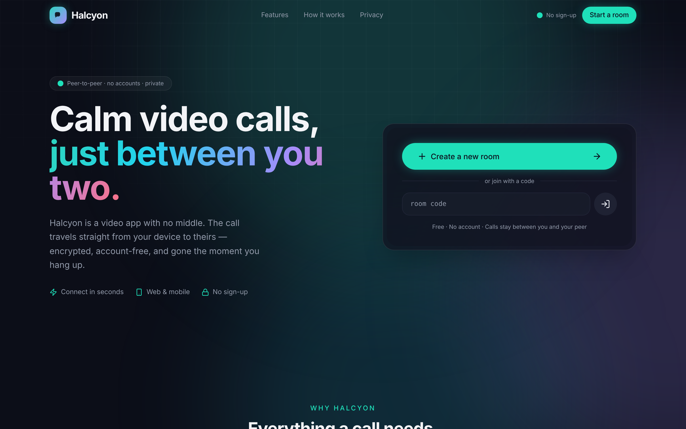
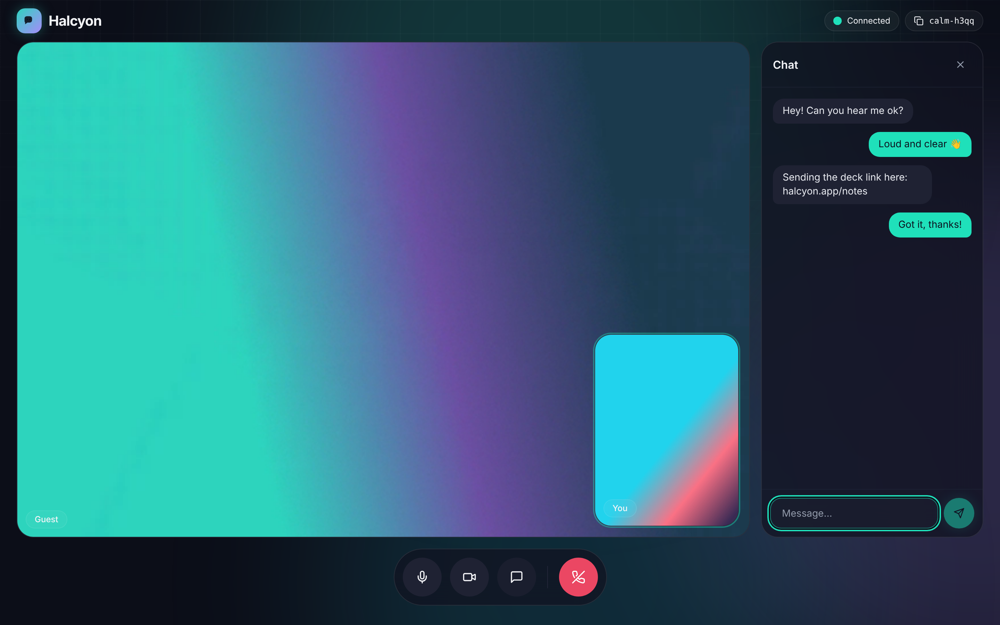
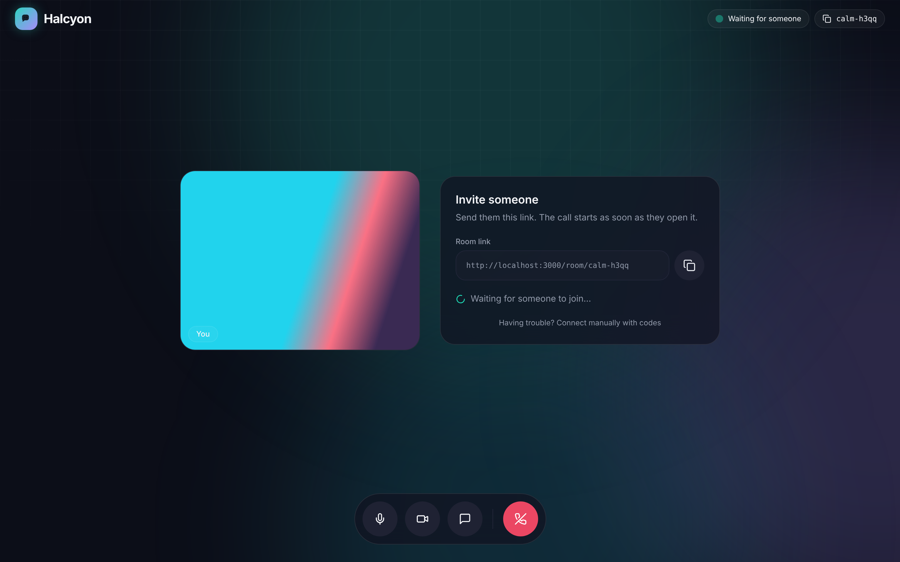
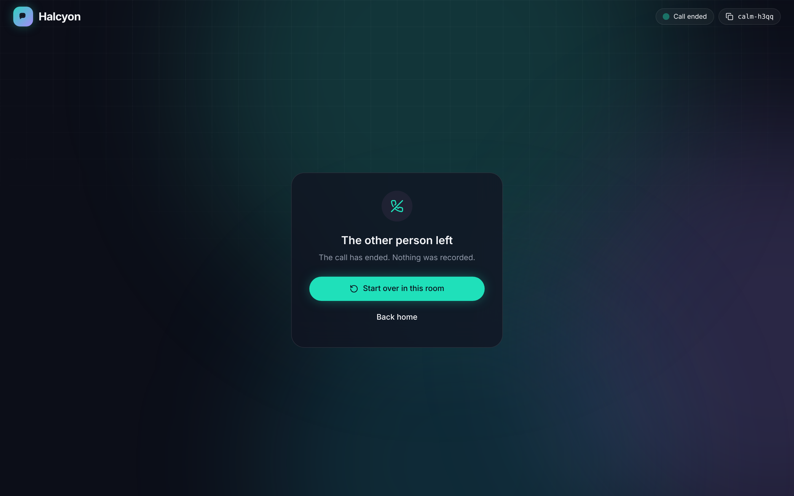
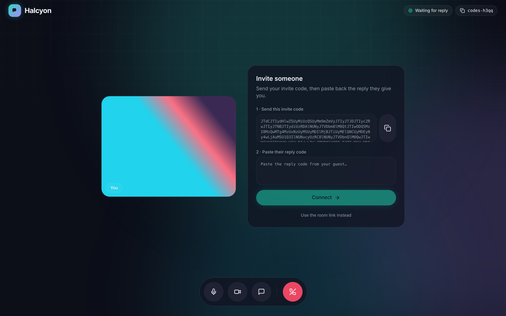
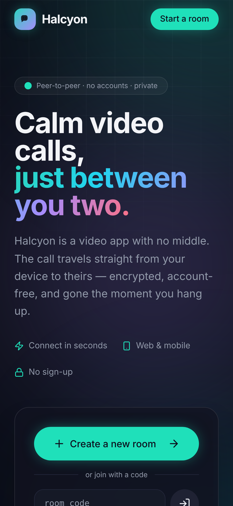
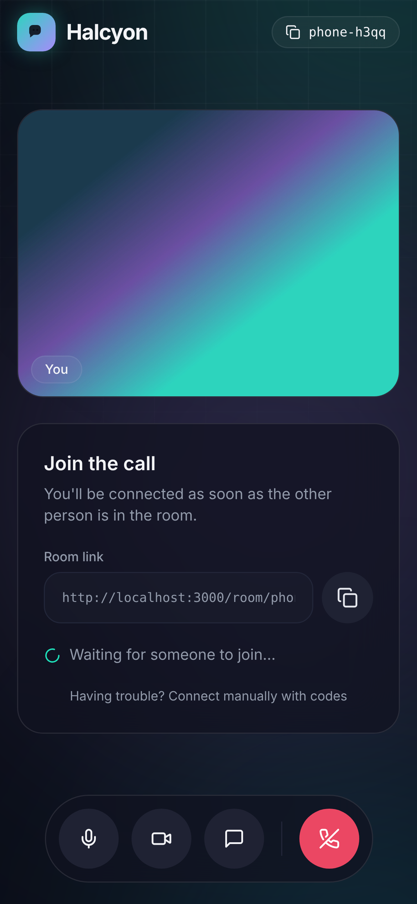
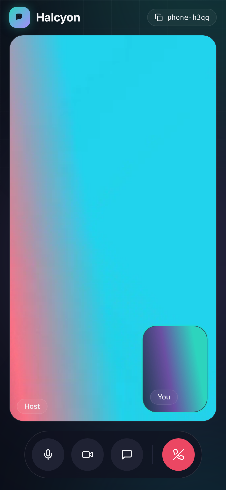

# Halcyon

Calm, private, peer-to-peer video calls. Built with **WebRTC**, **Next.js 14**, **shadcn/ui**, and **Tailwind CSS**. Works on web and mobile from a single responsive client.

<p align="center">
  
</p>

## Screenshots

| In a call, with chat | Waiting with the room link |
|---|---|
|  |  |
| **Call ended** | **Manual fallback (codes)** |
|  |  |

| Mobile landing | Mobile join | Mobile call |
|---|---|---|
|  |  |  |

Screenshots are captured from a real peer-to-peer call between two headless Chromium instances with fake cameras. Regenerate them with:

```bash
npm run build && npm start
```

```bash
npm run screenshots
```

## What's inside

- **Landing page** (`app/page.tsx`) — fully functional hero with a working "create room / join with code" widget, feature grid, how-it-works, and privacy section.
- **Video call client** (`components/room-client.tsx`) — responsive call stage. Desktop shows chat as a side panel; mobile uses a picture-in-picture self-view and a full-screen chat sheet.
- **WebRTC core** (`hooks/use-webrtc.ts`) — peer connection, camera/mic, mute/camera toggles, typed errors, reconnect grace period, and a `RTCDataChannel` for chat and call state.
- **Signaling relay** (`app/api/signal/[room]/route.ts`, `lib/signal-store.ts`, `lib/signaling.ts`) — a tiny long-polling mailbox that passes the handshake between the two peers of a room.

## Run it

```bash
npm install
npm run dev
```

Open http://localhost:3000.

> Camera/mic require a secure context. `localhost` works in dev. For two real devices, deploy over HTTPS (e.g. Vercel).

## How a call connects

1. Someone clicks *Create a new room* and sends the room link.
2. The other person opens it. That's it — the call starts on its own.

Under the hood both tabs join `/api/signal/<room>`, a small relay built into the app. It passes the WebRTC offer, answer and ICE candidates (trickled as they are found) between the two peers, then the media flows **directly** between devices over DTLS-SRTP. The relay never sees video, audio or chat; it only holds handshake messages for a couple of minutes, in memory. Rooms are limited to two people.

STUN servers (Google public) handle NAT traversal. For restrictive networks you'd add a TURN server to `ICE_SERVERS` in `hooks/use-webrtc.ts`.

### Manual fallback (no relay at all)

Under the room link there's *Connect manually with codes*: the host generates an invite code, the guest pastes it and sends back a reply code. Nothing goes through the relay in this mode.

### Hosting the relay

The relay keeps its state in the Node.js process, so it works anywhere a single long-running server runs: `npm start`, Docker, Fly.io, Railway, Render, a VPS. On serverless platforms with many short-lived instances (e.g. Vercel) the two peers may hit different instances; replace `lib/signal-store.ts` with a shared store (e.g. Redis) or plug a different transport into the `SignalingChannel` interface in `lib/signaling.ts` (WebSocket, Supabase Realtime, …).

## Tests

```bash
npm run build && npm start
```

```bash
npm run test:e2e
```

Runs full calls between headless Chromium peers (link mode, manual mode, errors, hang-up, room full). Requires Playwright with Chromium.

## Stack notes

- shadcn-style primitives live in `components/ui` (Button, Input, Tooltip).
- Design tokens (aurora palette, glass surfaces, motion) are in `tailwind.config.ts` + `app/globals.css`.
- No media or chat is recorded or stored. Closing the tab tears down the connection and frees the room seat.

## Roadmap

See [docs/PLAN.md](docs/PLAN.md) for the gap analysis and the plan to finish the app.
