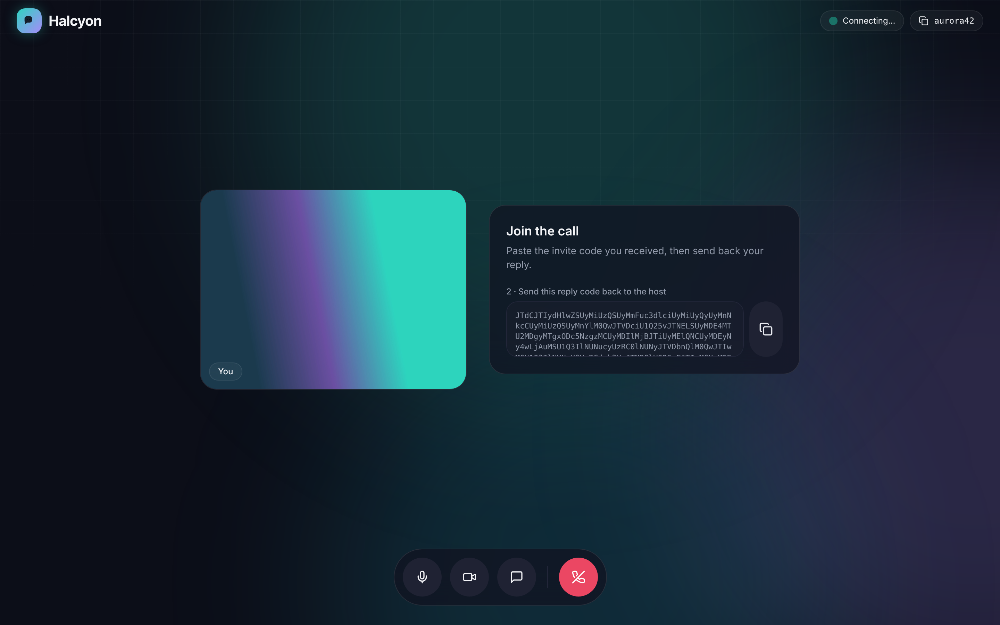

# Halcyon

Calm, private, peer-to-peer video calls. Built with **WebRTC**, **Next.js 14**, **shadcn/ui**, and **Tailwind CSS**. Works on web and mobile from a single responsive client.

<p align="center">
  
</p>

## Screenshots

| In a call, with chat | Invite flow (host) |
|---|---|
|  |  |
| **Reply flow (guest)** | **Waiting room** |
|  |  |

| Mobile landing | Mobile join | Mobile call |
|---|---|---|
|  |  |  |

Screenshots are captured from a real peer-to-peer call between two headless Chromium instances with fake cameras. Regenerate them with:

```bash
npm run build && npm start
```

```bash
npm run screenshots
```

## What's inside

- **Landing page** (`app/page.tsx`) — fully functional hero with a working "create room / join with code" widget, feature grid, how-it-works, and privacy section.
- **Video call client** (`components/room-client.tsx`) — responsive call stage. Desktop shows chat as a side panel; mobile uses a picture-in-picture self-view and a full-screen chat sheet.
- **WebRTC core** (`hooks/use-webrtc.ts`) — peer connection, camera/mic, mute/camera toggles, and a `RTCDataChannel` text chat. No backend required.

## Run it

```bash
npm install
npm run dev
```

Open http://localhost:3000.

> Camera/mic require a secure context. `localhost` works in dev. For two real devices, deploy over HTTPS (e.g. Vercel).

## How a call connects (serverless signaling)

There's no signaling server. Peers exchange one short code out of band:

1. **Host** clicks *Create a new room* → *Generate invite code*, copies the code, sends it to the guest.
2. **Guest** opens the room link, pastes the invite code → *Generate reply*, sends the reply code back.
3. **Host** pastes the reply code → *Connect*. You're live.

ICE candidates are gathered and bundled into the SDP before the code is produced, so a single copy/paste each way is enough. STUN servers (Google public) handle NAT traversal. For restrictive networks you'd add a TURN server to `ICE_SERVERS` in `hooks/use-webrtc.ts`.

### Going fully link-based (optional)

To skip copy/paste, drop in any signaling transport (WebSocket, Firebase, Supabase Realtime, PeerJS) and feed the offer/answer through it instead of the `SignalPanel`. The hook already exposes `createOffer`, `acceptOffer`, and `acceptAnswer` — wire those to your channel.

## Stack notes

- shadcn-style primitives live in `components/ui` (Button, Input, Tooltip).
- Design tokens (aurora palette, glass surfaces, motion) are in `tailwind.config.ts` + `app/globals.css`.
- No data is recorded or stored. Closing the tab tears down the connection.

## Roadmap

See [docs/PLAN.md](docs/PLAN.md) for the gap analysis and the plan to finish the app.
