# Halcyon

[](https://github.com/gekkolas/halcyon/actions/workflows/ci.yml)

Calm, private, peer-to-peer video calls. Built with **WebRTC**, **Next.js 14**, **shadcn/ui**, and **Tailwind CSS**. Works on web and mobile from a single responsive client.

<p align="center">
  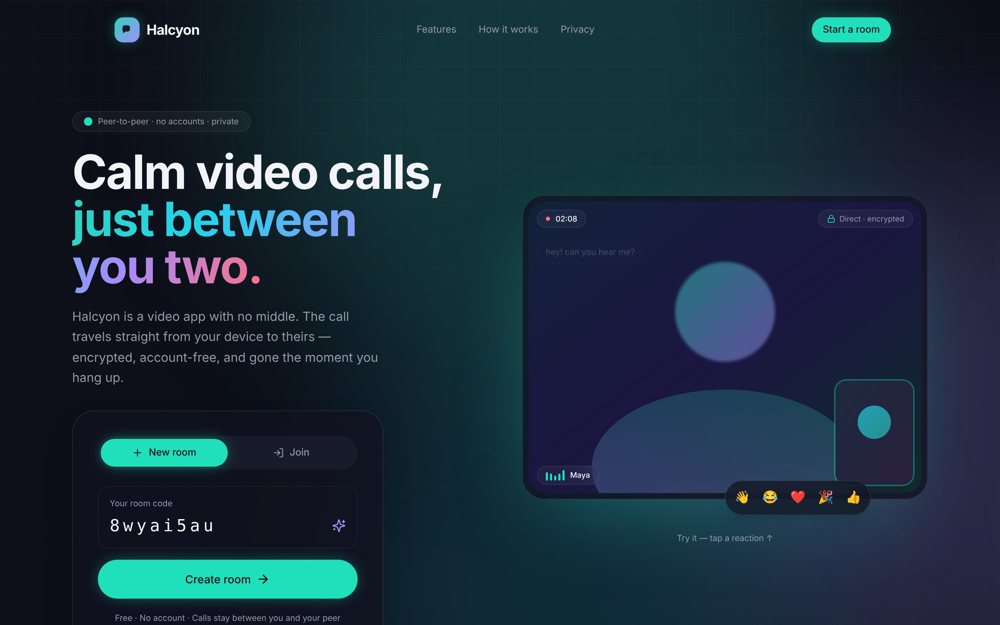
</p>

## Screenshots

### Landing

| Bento features with cursor spotlight | Auto-playing "how it works" |
|---|---|
| 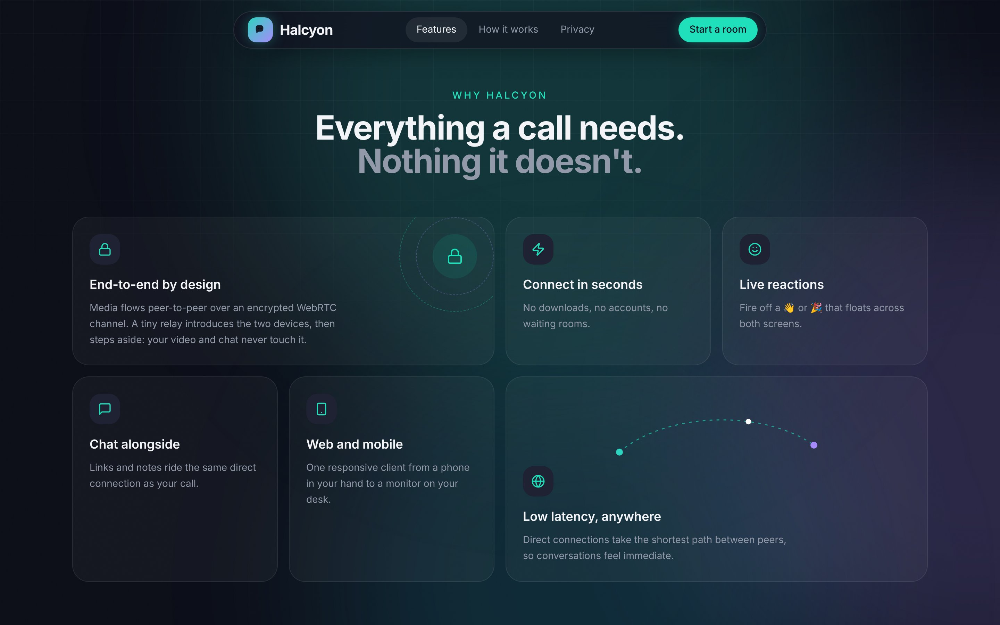 | 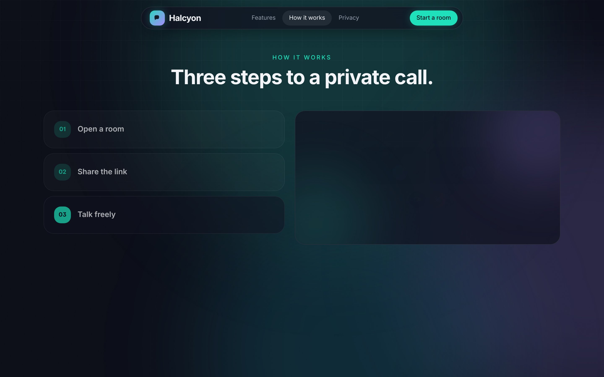 |

### Calls

| In a call | In a call, with chat |
|---|---|
| 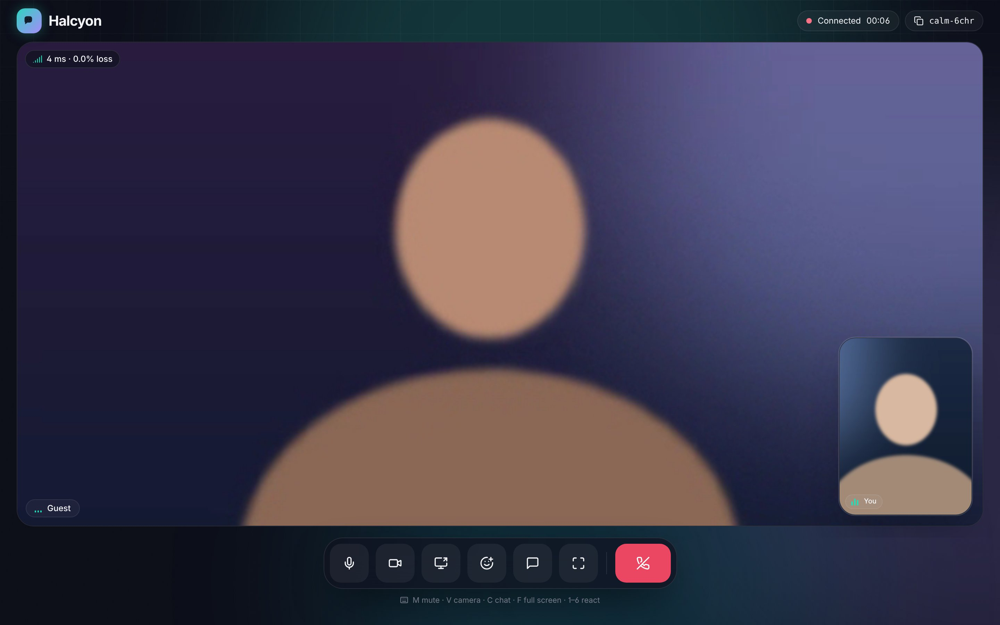 | 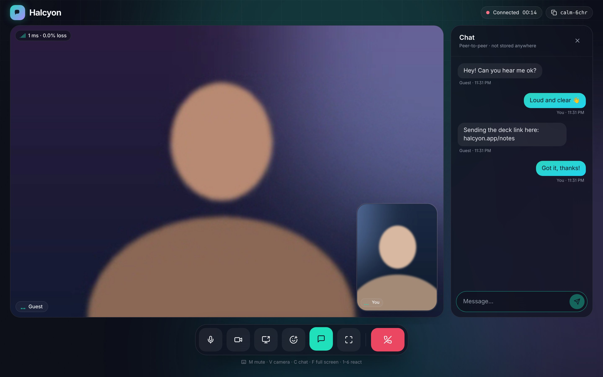 |
| **Waiting with the room link** | **Manual fallback (codes)** |
| 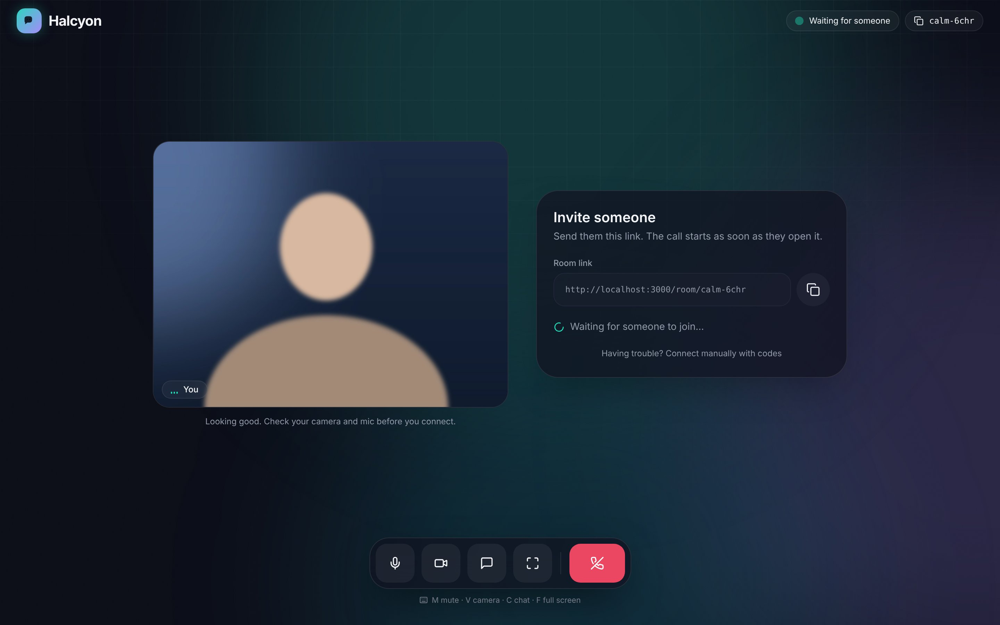 | 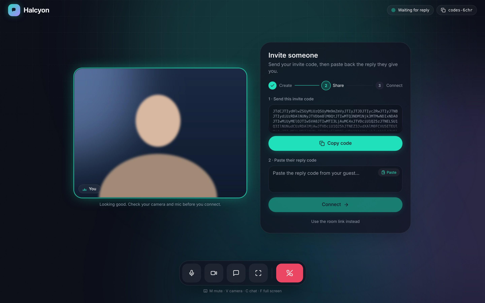 |
| **Call ended** | |
| 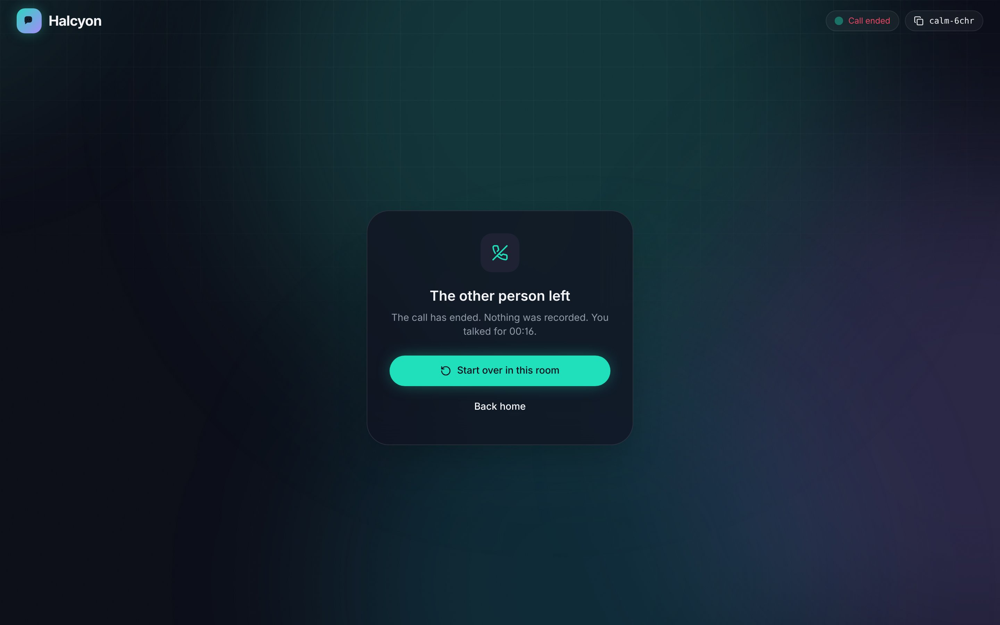 | |

### Mobile

| Landing | Joining by link | In a call |
|---|---|---|
| 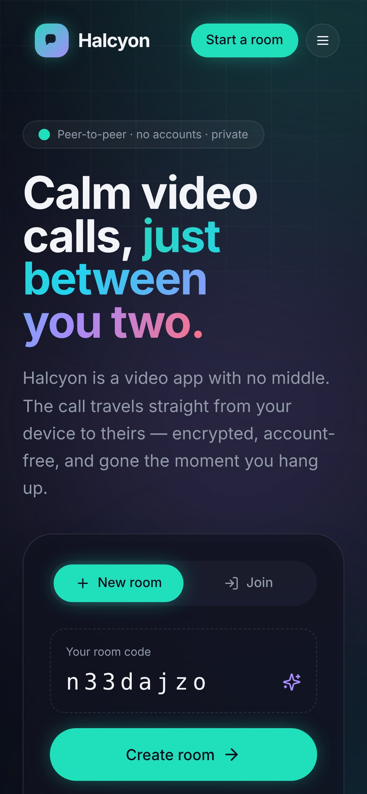 | 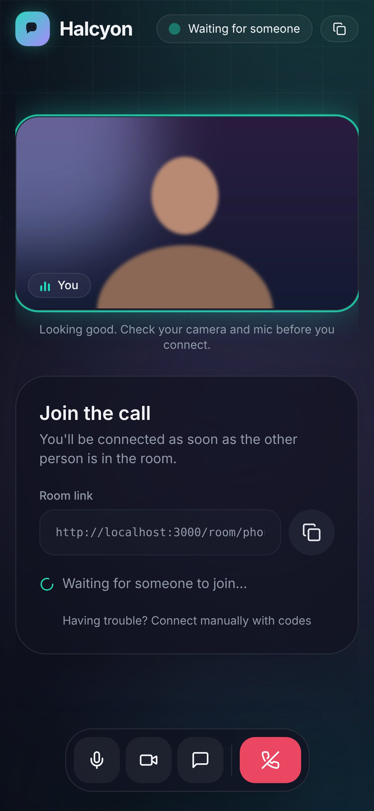 | 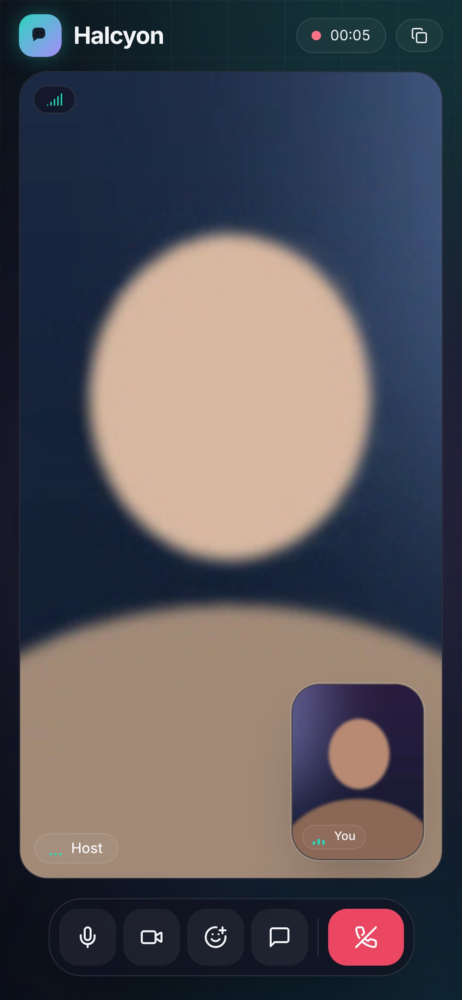 |

Screenshots are captured from a real peer-to-peer call between two headless Chromium instances with fake cameras. Regenerate them with:

```bash
npm run build && npm start
```

```bash
npm run screenshots
```

To swap Chromium's default test pattern for your own footage, pass a `.y4m` file per peer (e.g. made with `ffmpeg -i clip.mp4 -pix_fmt yuv420p host.y4m`):

```bash
node scripts/screenshots.mjs http://localhost:3000 host.y4m guest.y4m
```

## What's inside

- **Landing page** (`app/page.tsx`) — fully functional hero with a working "create room / join with code" widget, feature grid, how-it-works, and privacy section.
- **Video call client** (`components/room-client.tsx`) — responsive call stage. Desktop shows chat as a side panel; mobile uses a picture-in-picture self-view and a full-screen chat sheet.
- **Interactive UI** — floating navbar with active-section pill, 3D-tilt live call preview, spotlight bento cards, auto-playing how-it-works stepper, segmented room-code input (accepts pasted links).
- **In-call UX** — draggable picture-in-picture (double-click to swap), speaking indicators from live audio levels, emoji reactions over the data channel, call timer, auto-hiding controls, full screen, and keyboard shortcuts (`M` mute · `V` camera · `C` chat · `F` full screen · `1–6` react).
- **WebRTC core** (`hooks/use-webrtc.ts`) — peer connection, camera/mic, camera switching, screen sharing, reconnection, network stats, and a `RTCDataChannel` for chat, reactions and mic/camera state. The only server piece is the small handshake relay described below; media and chat never pass through it.

## Run it

```bash
npm install
npm run dev
```

Open http://localhost:3000.

> Camera/mic require a secure context. `localhost` works in dev. For two real devices, deploy over HTTPS (e.g. Vercel).

## How a call connects

1. Someone clicks *Create a new room* and sends the room link.
2. The other person opens it. That's it — the call starts on its own.

Under the hood both tabs join `/api/signal/<room>`, a small relay built into the app. It passes the WebRTC offer, answer and ICE candidates (trickled as they are found) between the two peers, then the media flows **directly** between devices over DTLS-SRTP. The relay never sees video, audio or chat; it only holds handshake messages for a couple of minutes, in memory. Rooms are limited to two people.

STUN servers (Google public) handle NAT traversal. For restrictive networks (symmetric NAT, many mobile carriers and offices) set a TURN server via `NEXT_PUBLIC_TURN_*` (see below and `lib/ice.ts`).

### Manual fallback (no relay at all)

Under the room link there's *Connect manually with codes*: the host generates an invite code, the guest pastes it and sends back a reply code. Nothing goes through the relay in this mode.

### Hosting the relay

The relay keeps its state in the Node.js process, so it works anywhere a single long-running server runs: `npm start`, Docker, Fly.io, Railway, Render, a VPS. On serverless platforms with many short-lived instances (e.g. Vercel) the two peers may hit different instances; replace `lib/signal-store.ts` with a shared store (e.g. Redis) or plug a different transport into the `SignalingChannel` interface in `lib/signaling.ts` (WebSocket, Supabase Realtime, …).

## Deploy

1. Copy `.env.example` to `.env.local` (or set the variables on your host):
   - `NEXT_PUBLIC_SITE_URL`: public URL, used for link previews.
   - `NEXT_PUBLIC_TURN_URLS`, `NEXT_PUBLIC_TURN_USERNAME`, `NEXT_PUBLIC_TURN_CREDENTIAL`: optional TURN relay (e.g. Cloudflare, Metered, or your own coturn). They are baked in at build time and visible to browsers.
   - `SIGNAL_RATE_LIMIT`: optional, requests per client IP per 10 s on the relay.
2. `npm ci && npm run build && npm start` behind HTTPS (camera access requires it). Use a single long-running Node process; see *Hosting the relay* above.

Production builds send a Content-Security-Policy, `Referrer-Policy: no-referrer` (room links are invitations), `Permissions-Policy` limited to camera/mic/screen for this origin, and `X-Frame-Options: DENY`. Room pages are `noindex`.

## Checks

```bash
npm run lint && npm run typecheck
```

```bash
npm run build && npm start
```

```bash
npm run test:e2e
```

Runs full calls between headless Chromium peers: link and manual modes, errors, hang-up, room full, camera switching, screen sharing, network stats and the relay's rate limit. The first time, install the browser with `npx playwright install chromium`. CI (`.github/workflows/ci.yml`) runs all of the above on every pull request.

The relay allows 300 requests per 10 s per client IP by default; change it with `SIGNAL_RATE_LIMIT`.

## Stack notes

- shadcn-style primitives live in `components/ui` (Button, Input, Tooltip).
- Animations use **framer-motion**; scroll reveals and spotlight hover helpers are in `components/motion.tsx`.
- Design tokens (aurora palette, glass surfaces, motion) are in `tailwind.config.ts` + `app/globals.css`.
- No media or chat is recorded or stored. Closing the tab tears down the connection and frees the room seat.

## Roadmap

See [docs/PLAN.md](docs/PLAN.md) for the gap analysis and the plan to finish the app.
